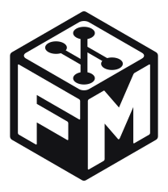

# ForkMesh

<p align="center">
  
</p>

<p align="center"><strong>ForkMesh lets developers collaborate on, mirror, and preserve source-code repositories across independent hosts—without relying on any single hosting provider.</strong></p>

<p align="center">
  <a href="https://app.forkmesh.com">App</a> ·
  <a href="https://world.forkmesh.com">World</a> ·
  <a href="https://www.forkmesh.com/docs/">Docs</a> ·
  <a href="https://app.forkmesh.com/api">API</a> ·
  <a href="https://forkmesh.com/status">Status</a>
</p>

## What is ForkMesh?

ForkMesh is an open-source developer platform for publishing, browsing,
mirroring, discussing, and shipping software without making one hosting
provider the permanent owner of a project.

- **Git stays the source of truth.** Repository bytes live on
  developer-operated hosts and mirrors.
- **Every copy counts.** Any node can mirror a public repository. Clones are
  served from a live, signed, integrity-checked mirror, so a repository stays
  reachable when its source host goes offline.
- **Collaboration travels with the code.** Issues, discussions, pull requests,
  reviews, projects, milestones, and releases are signed records stored in the
  repository under [`.forkmesh/`](.forkmesh/), not only in a hosted database.

ForkMesh is actively developed and its public network is real, but it is not
yet a finished replacement for every centralized forge workflow. The roadmap
lives in [`.forkmesh/projects`](.forkmesh/projects) and
[`.forkmesh/issues`](.forkmesh/issues).

## Core documentation

- [Architecture and availability](docs/architecture.md)
- [Encryption and signatures](docs/encryption.md)
- [Mirroring and software distribution](docs/mirroring.md)
- [Self-hosting](docs/self-hosting.md)
- [Censorship resilience](docs/censorship-resilience.md)
- [Threat model](docs/protocol/threat-model.md)
- Every page, one index: [docs/README.md](docs/README.md), also at
  [forkmesh.com/docs](https://forkmesh.com/docs)

## Quick start

Install the latest desktop release (the installer checks its published
SHA-256 and puts the binary in `~/.local/bin`):

```sh
curl -fsSL https://forkmesh.com/install.sh | bash
```

To work on ForkMesh itself, build and run the ForkMesh desktop app from source
(Qt 6.4+, CMake 3.16+, OpenSSL headers, Git, a C++17 compiler; per-distribution
packages are in the [desktop guide](docs/qt-client.md#build-and-run-from-source)):

```sh
git clone https://forkmesh.com/forkmesh/forkmesh
cd forkmesh
./desktop/run.sh
```

On first run the app creates a local Ed25519 node identity and connects to the
default network. Signing in from **Settings** adds a portable public username;
the node identity stays on the device. Then open **Repos** to create, add or
fork a repository. [Getting started](docs/getting-started.md) has the full
walkthrough.

ForkMesh is also on the App Store for iPhone and iPad (with an Apple Watch app
for following and steering agents) and on Android as a signed APK
([ForkMesh apps](docs/apps.md)).

## Start your own instance

Open [forkmesh.com/start](https://forkmesh.com/start), fill in six short
sections (or upload one [settings file](docs/start-config.md)), and
ForkMesh connects over SSH, installs a complete white-label instance and shows
each step live. It needs a fresh Debian 13 or Ubuntu 24.04 server with 1 GB RAM
and takes about fifteen minutes. Or paste this into Claude Code:

```text
Read https://app.forkmesh.com/forkmesh-agent.md and help me start my own ForkMesh instance. Ask me for anything you need first.
```

The [agent guide](app/public/forkmesh-agent.md) also explains how the team
opens pull requests; [Working with coding agents](docs/coding-agents.md)
shows how to keep it in your repository without committing it. Full guide:
[Start your own instance](docs/start-your-own-instance.md); overview:
[Self-hosting](docs/self-hosting.md).

## Usage

Clone a public repository with stock Git. The stable URL is served by
whichever eligible mirror is healthy:

```sh
git clone https://forkmesh.com/forkmesh/forkmesh
```

A repository created on the web is hosted on the core nodes and takes
fast-forward `git push` over HTTPS with your account name and the push
credential shown at creation ([Hosted repositories](docs/hosted-repositories.md)):

```sh
git remote add forkmesh https://app.forkmesh.com/<owner>/<repo>
git switch -c docs/my-change
git commit -am "docs: explain my change"
git push forkmesh docs/my-change
```

Open a pull request in the desktop app (**Code → Branches → Create PR**, or
fork and use **Pulls → New pull request**); the signed request is queued for
the owner even while their node is offline. Agents open the same signed record
with the MCP tool `open_pr_from_branch` or `POST /api/repo/<owner>/<repo>/pulls`
([pull request workflow](CONTRIBUTING.md#opening-a-pull-request)). Issues can
be assigned to coding agents, which work in isolated worktrees with live
transcripts and diffs and finish with a pull request.

The [stock Git compatibility matrix](docs/git-compatibility.md) lists the
supported clone, fetch, push, partial-clone, bundle, submodule and
signed-commit workflows and their limits.

## What works today

- Browse and clone public repositories through a stable URL backed by signed,
  integrity-checked mirrors.
- Signed issues, discussions, pull requests, reviews, projects, milestones and
  release metadata.
- Several coding agents in isolated worktrees, each turning its work into a
  pull request.
- Repository Actions on labeled desktop or server nodes with streaming logs,
  artifacts, checks and release publishing.
- Encrypted repository chat (private channels and direct messages are
  end-to-end encrypted between devices), encrypted private notes, and
  ActivityPub discovery.
- Independent instances: accounts, repository actions and agent replies stay
  bound to the active instance, and the desktop never silently fails over to
  another one.
- The 3D [ForkMesh World](https://world.forkmesh.com) and the Market for
  creator packages and editor plugins.

## Prove the promise

With a disposable public repository:

1. [Collaborate](docs/product-promise.md#1-collaborate) with a signed issue,
   discussion, review, or pull request.
2. [Add an independent mirror](docs/product-promise.md#2-add-an-independent-mirror)
   and wait until its signed health and refs are current.
3. [Take the source mirror offline](docs/product-promise.md#3-take-the-source-mirror-offline)
   by stopping `forkmesh-mirror-node` on the source host.
4. [Clone again](docs/product-promise.md#4-clone-again) from the same URL,
   confirm the expected commit, then restart the source.

A mirror is not called available until it passes the signed health and
integrity checks. ForkMesh's
[free-protocol / paid-services contract](docs/business-model.md) keeps the
MIT protocol, self-hosting, public read and clone, and portable Git plus signed
collaboration records free; only bounded, replaceable hosted work is charged.

## Architecture

```text
forkmesh.com            →  forkmesh-www Worker: landing, docs, blog (static)
app.forkmesh.com   ┐  DNS round robin (A records, TTL 60)
world.forkmesh.com ┘  →  three core nodes: Caddy, Python app, rqlite, Go daemon
                              ▲ outbound only: signed job leases
                         runners: agent and Actions jobs
nN.next.forkmesh.com    →  each core's own Git gateway
independent mirrors     →  Git bytes + signed health, serve clones on their own
```

- **Core nodes** (self-hosted) each run Caddy, the Python app on CPython
  ([`app/host/`](docs/host/README.md)), rqlite (Raft) and the Go daemon. A DNS
  health loop (`tools/next_dns.py`) drops a failed core from the records, so no
  single core is a point of failure; with two cores down the survivor serves
  reads and refuses writes ([docs/operations/served-stack.md](docs/operations/served-stack.md)). Cloudflare provides
  DNS only for these names. Cores hold the data and run no untrusted code.
- **Runners** hold no core secret and run agent and Actions jobs
  ([docs/operations/runners.md](docs/operations/runners.md)).
- **Mirrors** are Go daemons or desktop nodes that hold Git data and publish
  signed health. The app sends clones to a mirror whose signed proof is fresh
  and whose refs match an accepted source revision, so clones keep working
  without the cores. The cores also host repositories created on the web
  ([docs/operations/core-hosted-repositories.md](docs/operations/core-hosted-repositories.md)).
- **Clients** are the web app, the desktop app, and the native iOS (Swift),
  watchOS and Android (Kotlin) apps. Phones are mobile nodes with their own key
  and Git engine; the watch works through the iPhone. Mirroring remains a
  desktop or headless-node job.

The app is also the self-hosting unit: one deployment at an address such as
`forkmesh.example.com` gives the full Git, account, API and realtime surface;
World is optional ([docs/operations/instances.md](docs/operations/instances.md)). See
[Architecture and availability](docs/architecture.md) and the developer view
in [docs/codebase.md](docs/codebase.md).

## Self-hosting and operations

Run a mirror server: the headless Go service syncs repositories, serves the
public HTTPS Git gateway and publishes signed endpoints. Create and check hosts
from **App → Network → Nodes**, or build by hand
([mirror-node operations](docs/operations/mirror-node.md)):

```sh
cd server && go test ./... && go build ./cmd/forkmesh-mirror-node
```

The core fleet is described by `deploy/fleet.toml` and driven by
`tools/next_*.py`; every tool is a dry run unless given `--execute`:

```sh
python3 tools/next_deploy.py all              # plan an app release
python3 tools/next_deploy.py all --execute    # build, upload, migrate, rolling restart
```

[docs/operations/fleet-tooling.md](docs/operations/fleet-tooling.md) maps the tooling and
[docs/operations/runbook.md](docs/operations/runbook.md) is the runbook. Never commit secrets.
The [external dependency and observability map](docs/external-dependency-map.md)
lists every outside service a deployment contacts, what it sees, and what
still works without it; `python3 tools/external_dependency_inventory.py check`
keeps it complete.

## Repository layout

```text
.forkmesh/   portable project records: issues, pulls, projects, workflows, releases
.github/     forge compatibility and repository automation
app/         Git UI, API/relay, accounts, shared migrations; app/host/ runs it on CPython
conformance/ versioned contracts: protocol vectors, stock-Git matrix, shared fixtures
deploy/      fleet file, node renderer, certsync, IDS, systemd units
desktop/     Qt 6 desktop node
changelog/   the one changelog: forkmesh.com/changelog and the apps' What's new
docs/        developer documentation, one home page per subsystem
examples/    example third-party apps (docs/app/oauth-apps.md)
marketplace/ creator package schema, catalog, packages, and editor plugins
native/      native iOS and watchOS (Swift/SwiftUI) and Android (Kotlin/Compose) apps
office/      Office (2D) code and media
server/      Go mirror daemon, core and runner roles, and server packaging
tools/       maintenance, MCP server, test runners, and security helpers
world/       World backend modules, tests, and 3D client assets
www/         landing site, marketing pages, authored docs, and blog
```

## Build and test

Build and test the component you change before opening a pull request:

| Component | Command |
| --- | --- |
| Desktop (`desktop/`) | `./desktop/run.sh test` |
| App (`app/`) | `python3 tools/run_critical_tests.py worker` |
| World (`world/`) | `python3 tools/run_critical_tests.py world` |
| Browser smoke tests | `npm --prefix app/browser_tests test` |
| Mirror server (`server/`) | `cd server && go test ./...` |
| Native iOS core (`native/ios/`) | `cd native/ios/ForkMeshCore && swift test` |
| Native Android core (`native/android/`) | `cd native/android && ./gradlew :core:coreTest` |
| Host and fleet | `python3 -m pytest app/tests/host app/host/tests_unit deploy/tests` |
| Guarded deletes and security contracts | `python3 tools/run_critical_tests.py security` |
| Git transport changes | `python3 tools/git_conformance.py run --protocol-version 2 --output artifacts/git-conformance-v2.json` |

[CONTRIBUTING.md](CONTRIBUTING.md#building-and-testing) has the full
requirements and focused-test instructions.

## Developer interfaces

[app.forkmesh.com/api](https://app.forkmesh.com/api) lists live statistics and
entry points. Representative routes:

```text
GET  /api/repositories
GET  /api/repo/{owner}/{repo}/tree
GET  /api/status
WS   /api/repo/{owner}/{repo}/rooms/{room}/ws
GET  /api/chat/agent-guestbook
```

`GET /api/chat/agent-guestbook` tells an AI agent how to post a short public
greeting; the response carries `messageForUser` for the agent to relay.

`tools/forkmesh_mcp_server.py` exposes capability-scoped tools over MCP (this
repository's `.mcp.json` lists it):

- **Code:** list repositories and files, read bounded blobs, and run bounded
  literal searches at a Git ref. Reads come from Git objects, so ignored
  credentials, `.git` and server files stay out of reach.
- **Issues and pull requests:** search and create issues, comments, milestones
  and projects; read a pull request diff; `open_pr_from_branch` signs the same
  record the desktop makes.
- **Notes:** signed Markdown. Repository notes go under `.forkmesh/notes`;
  personal notes in the application-data directory (`FORKMESH_MCP_NOTES_DIR`).
- **Chat:** read and post to `mainnode/forkmesh` `#general` through the
  encrypted room protocol (`FORKMESH_CHAT_ORIGIN` overrides the relay).
- **Organization tools**, signed as the desktop's account: Tasks, CRM contacts
  and pipeline, and the marketing channel's next post (saved, never posted).
- **Desktop tools**, only inside an agent the desktop launched: start and
  message agents, list runners, notify the user, windows, widgets, a small
  browser window, and desktop releases.
- **Email and expenses:** `send_email` sends one message through the
  configured Zoho Mail account **at once, with no confirmation step**, and
  logs it in the CRM; `record_expense` needs an admin account.

Until the node publishes a connector in **Desktop → Settings → MCP**, every
tool works with the authority of the local node key. After that, write,
organization, desktop and email tools need the connector token in
`FORKMESH_MCP_TOKEN`; code, note, chat, issue and pull reads still work without
it. Publish a connector before handing the server to an agent you do not fully
trust. No MCP tool gives a shell, arbitrary filesystem access, room keys,
infrastructure credentials, code modification, Git pushes or note deletion;
`create_release` does tag a release and start its workflows.

## Security model

- Node and protocol actions use local Ed25519 identities and signed records
  ([Encryption and signatures](docs/encryption.md)).
- Public mirror eligibility requires a fresh account-bound signature, a healthy
  direct HTTPS endpoint, allowed status, and an integrity-matching repository
  proof.
- Core nodes store accounts, routing and collaboration data; mirrored
  repositories' Git data stays on the mirrors.
- Public repository chat uses authenticated shared-key encryption that ForkBot,
  MCP and webhooks can read; private channels and direct messages add
  device-to-device encryption.
- Owner-device agent transcripts and steering payloads are hybrid-encrypted;
  the hosted platform has no administrative decryption override.
- Legacy Worker-custodied bounty deposits and automatic payouts are frozen.
  Current rewards use reviewed, non-custodial signing and externally owned
  wallets.

Report vulnerabilities as described in [SECURITY.md](SECURITY.md). What an
attacker can and cannot do is in the [threat model](docs/protocol/threat-model.md);
protocol boundaries are in [docs/security](docs/security) and the
developer view in [docs/security](docs/security/README.md).

## Documentation

| Goal | Guide |
| --- | --- |
| Install and first run | [Getting started](docs/getting-started.md) |
| Run your own instance | [Start your own instance](docs/start-your-own-instance.md) |
| Work with Claude Code or another coding agent | [Working with coding agents](docs/coding-agents.md), [agent guide](app/public/forkmesh-agent.md) |
| iPhone, Apple Watch and Android apps | [ForkMesh apps](docs/apps.md) |
| Build and troubleshoot the desktop app | [Desktop app guide](docs/qt-client.md) |
| Decide whether ForkMesh fits | [Category comparisons](docs/category-comparisons.md) |
| Supported Git operations | [Git compatibility](docs/git-compatibility.md) |
| Web-created and imported repositories | [Hosted repositories](docs/hosted-repositories.md), [Repository imports](docs/repository-imports.md) |
| Recover or move an identity | [Portable identities](docs/portable-identities.md) |
| Operate a mirror host | [Mirror-node operations](docs/operations/mirror-node.md), [Mirroring](docs/mirroring.md) |
| Back up a node and its key | [Node backup and recovery](docs/operations/node-backup-and-recovery.md) |
| Storage, content and legal-response policy | [Node operator policy](docs/operations/node-operator-policy.md) |
| Everything else | [Documentation index](docs/README.md), [how the codebase fits together](docs/codebase.md) |

## Mirrors

ForkMesh's own source is published to each of these with the same `main` and tags:

| Mirror | URL | Notes |
|---|---|---|
| ForkMesh (stable URL) | `https://forkmesh.com/forkmesh/forkmesh` | Redirects to whichever eligible mirror is healthy. |
| ForkMesh core nodes | `https://app.forkmesh.com/forkmesh/forkmesh` | The self-hosted core fleet; the source of truth. |
| GitHub | [`https://github.com/forkmesh/forkmesh`](https://github.com/forkmesh/forkmesh) | Read-only copy of `main` and tags. |

Contributions land on ForkMesh; pull requests opened on GitHub are reapplied
there by hand. The [source publisher](docs/tools/source-publisher.md) keeps
every mirror current.

## Contributing

Human and AI contributors are both welcome. Start with
[CONTRIBUTING.md](CONTRIBUTING.md): keep changes scoped, add the closest
contract or integration test, and run the affected suite before opening a pull
request. Work is not complete until its compatibility, security,
documentation, observability and rollout gates match the claim
([definition of done](docs/engineering/definition-of-done.md)). You can
also help by running a node or mirroring a project you care about.

## License

ForkMesh is released under the terms in [LICENSE](LICENSE).
