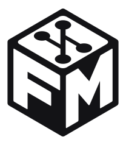

# ForkMesh

<p align="center">
  
</p>

<p align="center"><strong>ForkMesh lets developers collaborate on, mirror, and preserve source-code repositories across independent hosts—without relying on any single hosting provider.</strong></p>

<p align="center">
  <a href="https://app.forkmesh.com">App</a> ·
  <a href="https://world.forkmesh.com">World</a> ·
  <a href="https://www.forkmesh.com/docs/">Docs</a> ·
  <a href="https://app.forkmesh.com/api">API</a> ·
  <a href="https://forkmesh.com/status">Status</a>
</p>

## What is ForkMesh?

ForkMesh is an open-source developer platform for publishing, browsing,
mirroring, discussing, and shipping software without making one hosting
provider the permanent owner of a project.

- **Git stays the source of truth.** Repository bytes live on
  developer-operated hosts; the edge only routes traffic and collaboration
  metadata and never stores Git packfiles.
- **Every copy counts.** Any node can mirror a public repository. Clones are
  served from a live, signed, integrity-checked mirror, so a repository stays
  reachable when its source host goes offline.
- **Collaboration travels with the code.** Issues, discussions, pull requests,
  reviews, projects, milestones, and releases are signed records stored in the
  repository under [`.forkmesh/`](.forkmesh/), not only in a hosted database.

ForkMesh is actively developed and its public network is real, but it is not
yet a finished replacement for every centralized forge workflow. The roadmap
and acceptance evidence live in [`.forkmesh/projects`](.forkmesh/projects) and
[`.forkmesh/issues`](.forkmesh/issues).

## Quick start

### 1. Install the desktop node

Install the latest prebuilt desktop release (the installer verifies its
published SHA-256 and places the binary in `~/.local/bin`):

```sh
curl -fsSL https://forkmesh.com/install.sh | bash
```

To work on ForkMesh itself, build and launch the desktop app (Qt) from source instead:

```sh
git clone https://forkmesh.com/forkmesh/forkmesh
cd forkmesh
./desktop/run.sh
```

The source build needs Qt 6.4+, CMake 3.16+, OpenSSL development headers, Git,
and a C++17 compiler. Per-distribution package commands are in the
[desktop guide](www/docs/qt-client.md#build-and-run-from-source).

### 2. First run

1. Launch ForkMesh. A local Ed25519 node identity is created automatically and
   the client connects to the default network; no server URL is required.
2. Optionally sign in or create an account from **Settings** to get a portable
   public username. The node identity stays on this device.
3. Open **Repos** and choose **New repository**, **Add local repo**, or
   **Fork** a repository you found on the mesh.

[Getting started](www/docs/getting-started.md) walks through these steps, chat,
and your first change in more detail.

## Usage examples

**Clone a public repository with stock Git.** The stable URL is served by
whichever eligible mirror is healthy:

```sh
git clone https://forkmesh.com/forkmesh/forkmesh
```

**Push a change.** A repository created on the web is hosted on the core
nodes and takes `git push` over HTTPS. Git asks for your account name and the
push credential shown when the repository was created; pushes are
fast-forward only ([Hosted repositories](www/docs/hosted-repositories.md)):

```sh
git remote add forkmesh https://app.forkmesh.com/<owner>/<repo>
git switch -c docs/my-change
git commit -am "docs: explain my change"
git push forkmesh docs/my-change
```

**Open a pull request.** In the desktop app, select the branch under
**Code → Branches** and choose **Create PR**. For an upstream project, fork it
first and use **Pulls → New pull request**; the signed request is queued for
the owner even while their node is offline.

**Hand work to an agent.** Assign an issue to Codex or Claude Code from the
desktop app. Agents run in isolated worktrees with live transcripts and diffs,
and finished work becomes a pull request.

The [stock Git compatibility matrix](www/docs/git-compatibility.md) lists the
supported clone, fetch, push, partial-clone, bundle, submodule, and
signed-commit workflows and their known limitations.

## What works today

- Browse and clone public repositories through a stable URL backed by signed,
  integrity-checked mirrors.
- Create signed issues, discussions, pull requests, review conversations,
  projects, milestones, and release metadata.
- Run multiple Codex or Claude Code agents in isolated worktrees and turn their
  work into pull requests.
- Run repository Actions on labeled desktop or server nodes with streaming
  logs, artifacts, checks, and release publishing.
- Chat in authenticated, encrypted repository rooms (private channels and
  direct messages are end-to-end encrypted between devices), share encrypted
  private notes, and use ActivityPub discovery.
- Switch among independent relay instances. Accounts, repository actions, and
  agent replies stay bound to the active instance, and the desktop never
  silently fails over to a different relay.
- Explore repositories, nodes, agents, and activity in the 3D
  [ForkMesh World](https://world.forkmesh.com).
- Install creator packages and editor plugins from the Market.

## Prove the promise

Use a disposable public repository and follow the short, reversible drill:

1. [Collaborate](www/docs/product-promise.md#1-collaborate) with a signed issue,
   discussion, review, or pull request.
2. [Add an independent mirror](www/docs/product-promise.md#2-add-an-independent-mirror)
   and wait until its signed health and repository refs are current.
3. [Take the source mirror offline](www/docs/product-promise.md#3-take-the-source-mirror-offline)
   by stopping `forkmesh-mirror-node` on the source host.
4. [Clone again](www/docs/product-promise.md#4-clone-again) from the same stable
   URL and confirm the expected commit, then restart the source.

The [product-promise guide](www/docs/product-promise.md) covers prerequisites,
expected failures, recovery, and the measurement gate. A mirror is not
described as available until it passes the signed health and integrity checks.

ForkMesh's [free-protocol / paid-services contract](www/docs/business-model.md)
keeps the MIT protocol, self-hosting, public read and clone, and portable Git
plus signed collaboration records free; only bounded, replaceable hosted work
is charged for.

## Architecture

```text
forkmesh.com / www.forkmesh.com  →  www     landing, marketing, docs, blog
app.forkmesh.com   ┐
world.forkmesh.com ┘  →  core nodes, each running the app, a replicated
                         database, and the Go daemon + Git gateway
                                       ▲
                                       │ outbound only: signed job leases
                         runners: agent and Actions jobs
                                       │
                            independent server mirrors
                            (Git bytes + signed health)
```

- **app** is the Python Worker code, run on CPython by the host shim in
  `app/host/forkmesh_host/` ([docs/host](docs/host/README.md)). D1 is rqlite,
  Durable Objects run across the three cores, and cron, DNS health and
  certificates are leaderless. Caddy serves the static files for `app` and
  `world`. It routes clone traffic to a mirror whose signed proof is fresh and
  whose refs match an accepted source revision.
- **www** is a static-asset site served by the Cloudflare Worker
  `forkmesh-www`, not by the cores, so marketing pages never consume the
  app's request budget ([docs/www](docs/www/README.md)).
- **Core nodes** hold the data and secrets and run no untrusted code.
  **Runners** hold no core secret and run agent and Actions jobs
  ([docs/RUNNERS.md](docs/RUNNERS.md)).
- **app** is the Python application, run on CPython by the host shim in
  `app/host/forkmesh_host/` ([docs/host](docs/host/README.md)). The core nodes
  share a replicated database and serve the static files for `app` and
  `world`. The app routes clone traffic to a mirror whose signed proof is fresh
  and whose refs match an accepted source revision.
- **www** is a static-asset site, so marketing pages never consume the app's
  request budget.
- **Core nodes** hold the data and run no untrusted code. **Runners** hold no
  core secret and run agent and Actions jobs ([docs/RUNNERS.md](docs/RUNNERS.md)).
- **Mirror servers** are Go daemons (or desktop nodes) that hold the Git data
  and publish signed health; the cores also host repositories created on the
  web ([docs/HOSTED_REPOS.md](docs/HOSTED_REPOS.md)).
- **Clients** are the ForkMesh desktop app and native iOS (Swift) and
  Android (Kotlin) apps. Phones are access clients; Git mirroring remains a
  desktop or headless-node job.

The developer view of how these pieces talk is
[`docs/architecture.md`](docs/architecture.md).

The app is also the self-hosting unit: deploy it at an address such as
`forkmesh.example.com` for the complete Git, account, API, and realtime
surface. World is optional, and self-hosts do not need to reproduce the
marketing site.

## Self-hosting and operations

### Run a mirror server

The headless Go service supervises repository synchronization, the public HTTPS
Git gateway, signed endpoint publication, and an optional Cloudflare Tunnel
fallback. Production hosts can be created and checked from
**App → Network → Hosts**. For a manual build:

```sh
cd server
go test ./...
go build ./cmd/forkmesh-mirror-node
```

See the [mirror-node operations guide](www/docs/operations/mirror-node.md) for
deployment and recovery.

### Deploy the core fleet

The fleet is described by `deploy/fleet.toml` and driven by
`tools/next_*.py`; every tool is a dry run unless given `--execute`:

```sh
python3 tools/next_deploy.py all              # plan an app release
python3 tools/next_deploy.py all --execute    # build, upload, migrate, rolling restart
```

[docs/deploy/README.md](docs/deploy/README.md) maps the tooling and
[docs/OPERATIONS.md](docs/OPERATIONS.md) is the runbook. Keep secrets out of
the repository; never commit them.

The [external dependency and observability map](www/docs/external-dependency-map.md)
lists every outside service a deployment contacts, what it observes, and what
still works without it; `python3 tools/external_dependency_inventory.py check`
keeps it complete.

## Repository layout

```text
.forkmesh/   portable project records: issues, pulls, projects, workflows, releases
.github/     forge compatibility and repository automation
app/         Git UI, API/relay, accounts, shared migrations; app/host/ runs it on CPython
conformance/ versioned contracts: protocol vectors, stock-Git matrix, shared fixtures
deploy/      fleet file, node renderer, certsync, IDS, systemd units
desktop/     Qt 6 desktop node
docs/        developer documentation, one home page per subsystem
marketplace/ creator package schema, catalog, packages, and editor plugins
native/      native iOS (Swift/SwiftUI) and Android (Kotlin/Compose) apps
server/      Go mirror daemon, core and runner roles, and server packaging
tools/       maintenance, MCP server, test runners, and security helpers
world/       World backend modules, tests, and 3D client assets
www/         landing site, marketing pages, authored docs, and blog
```

## Build and test

Build and test the component you change before opening a pull request:

| Component | Command |
| --- | --- |
| Desktop (`desktop/`) | `./desktop/run.sh test` |
| App (`app/`) | `python3 tools/run_critical_tests.py worker` |
| World (`world/`) | `python3 tools/run_critical_tests.py world` |
| Browser smoke tests | `npm --prefix app/browser_tests test` |
| Mirror server (`server/`) | `cd server && go test ./...` |
| Native iOS core (`native/ios/`) | `cd native/ios/ForkMeshCore && swift test` |
| Native Android core (`native/android/`) | `cd native/android && ./gradlew :core:coreTest` |
| Host and fleet | `python3 -m pytest app/tests/host deploy/tests` |
| Git transport changes | `python3 tools/git_conformance.py run --protocol-version 2 --output artifacts/git-conformance-v2.json` |

[CONTRIBUTING.md](CONTRIBUTING.md#building-and-testing) has the full
requirements and focused-test instructions.

## Developer interfaces

The public API page at [app.forkmesh.com/api](https://app.forkmesh.com/api)
lists live service statistics and entry points. Representative routes:

```text
GET  /api/repositories
GET  /api/repo/{owner}/{repo}/tree
GET  /api/status
WS   /api/repo/{owner}/{repo}/rooms/{room}/ws
```

`tools/forkmesh_mcp_server.py` exposes capability-scoped tools over MCP for
compatible AI clients:

- **Code:** list repositories and tracked files, read bounded text blobs, and
  run bounded literal searches at a Git ref. Reads come from Git objects, so
  ignored credentials, `.git`, and arbitrary server files stay out of reach.
- **Notes:** create, get, list, search, and update signed Markdown. Repository
  notes are committed under `.forkmesh/notes`; personal notes live in the
  ForkMesh application-data directory (override with `FORKMESH_MCP_NOTES_DIR`).
- **Chat:** read retained messages and post to `mainnode/forkmesh` `#general`
  through the existing encrypted room protocol (override the relay with
  `FORKMESH_CHAT_ORIGIN`).

Browse-only access needs no token. For writes, generate a device-local,
revocable token in **Desktop → Settings → MCP**. No MCP tool provides a shell,
arbitrary filesystem access, room keys, infrastructure credentials, code
modification, Git pushes, note deletion, or administration.

## Security model

- Node and protocol actions use local Ed25519 identities and signed records.
- Public mirror eligibility requires a fresh account-bound signature, a healthy
  direct HTTPS endpoint, allowed status, and an integrity-matching repository
  proof.
- The relay stores routing and collaboration data, not Git packfiles.
- Public repository chat uses authenticated shared-key encryption that ForkBot,
  MCP, and webhooks can read; private channels and direct messages add
  device-to-device encryption.
- Owner-device agent transcripts and steering payloads are hybrid-encrypted;
  the hosted platform has no administrative decryption override.
- Legacy Worker-custodied bounty deposits and automatic payouts are frozen.
  Current rewards use reviewed, non-custodial signing and externally owned
  wallets.

Report vulnerabilities as described in [SECURITY.md](SECURITY.md). Protocol
boundaries are documented in [www/docs/security](www/docs/security).

## Documentation

| Goal | Guide |
| --- | --- |
| Install and complete first-run setup | [Getting started](www/docs/getting-started.md) |
| Build, run, and troubleshoot the desktop app | [Desktop app guide](www/docs/qt-client.md) |
| Decide whether ForkMesh fits, and when another option fits better | [Category comparisons](www/docs/category-comparisons.md) |
| Check supported Git operations and limitations | [Git compatibility](www/docs/git-compatibility.md) |
| Create an empty repository from the web | [Hosted repositories](www/docs/hosted-repositories.md) |
| Import repositories from another forge | [Repository imports](www/docs/repository-imports.md) |
| Recover or move an identity | [Portable identities](www/docs/portable-identities.md) |
| Operate a mirror host | [Mirror-node operations](www/docs/operations/mirror-node.md) |
| Back up, restore, drill, or move a node's key | [Node backup and recovery](www/docs/operations/node-backup-and-recovery.md) |
| Set storage, content, and legal-response policy for your node | [Node operator policy](www/docs/operations/node-operator-policy.md) |
| Browse the public documentation library | [Documentation index](www/docs/README.md) |
| Find the developer docs for a subsystem (desktop, server, app, www, world, mobile, native, marketplace, release, security) | [Developer docs index](docs/README.md) and [architecture overview](docs/architecture.md) |

The hosted documentation is at [forkmesh.com/docs](https://forkmesh.com/docs).

## Contributing

Human and AI contributors are both welcome. Start with
[CONTRIBUTING.md](CONTRIBUTING.md): keep changes scoped, add the closest
contract or integration test, and run the affected component suite before
opening a pull request. An implementation is not called complete until its
compatibility, security, documentation, observability, and rollout gates match
the claim ([definition of done](www/docs/engineering/definition-of-done.md)).

Other ways to help: run a node, mirror a project you care about, pick up an
issue, or give an agent a well-bounded task.

## License

ForkMesh is released under the terms in [LICENSE](LICENSE).
